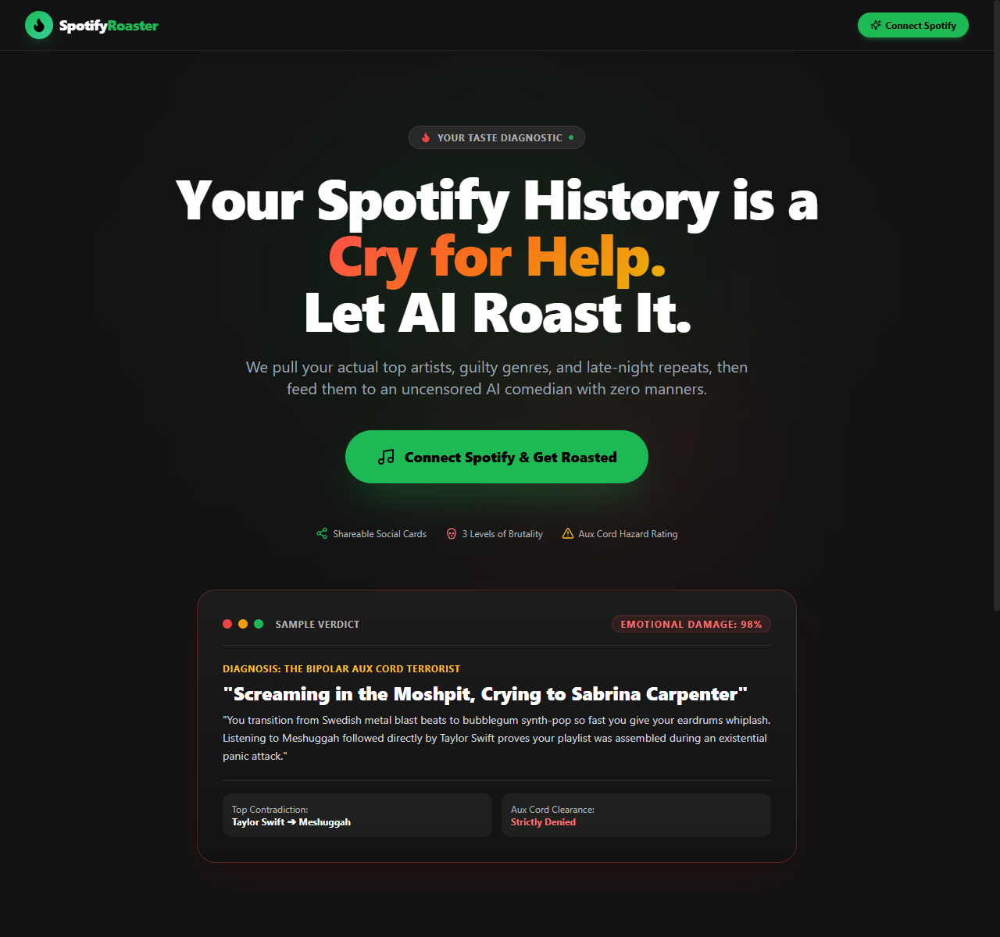
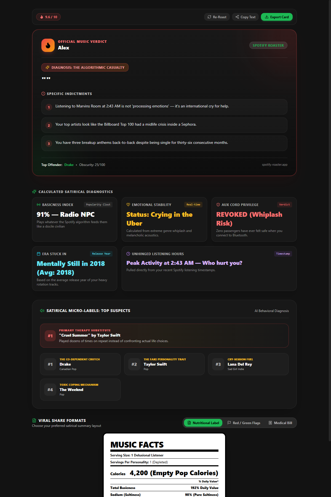
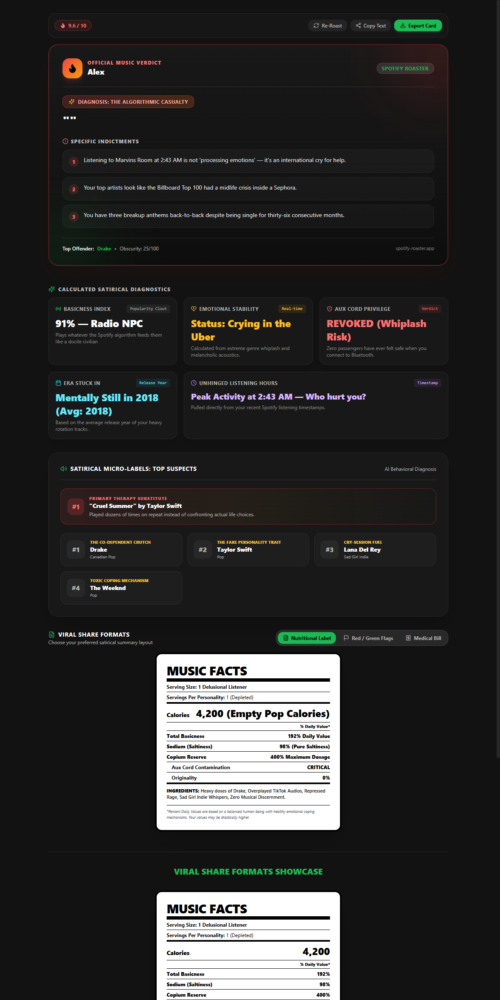

<div align="center">

# 🔥 Spotify Roast App

**Your Spotify history is a cry for help. Let AI roast it.**

An uncensored, satirical AI-powered web app that connects to your Spotify listening history, analyzes your guilty habits and audio contradictions, and delivers hilarious, brutal, and shareable roast cards.

[](https://nextjs.org/)
[](https://aistudio.google.com/)
[](https://developer.spotify.com/)
[](https://tailwindcss.com/)

<br />

<p align="center">
  
</p>

</div>

---

## 🌟 Highlights & Features

### 1. 🤖 Uncensored AI Roast Engine
* Powered by Google's **Gemini 3.5 Flash-Lite** structured JSON outputs.
* Ingests multi-range listening data (`short_term` and `medium_term`) across top artists, top tracks, release dates, and late-night timestamps.
* Delivers sharp comedic headlines, psychological breakdowns, personalized burns, and an Aux Cord Hazard rating.

### 2. 🎚️ 3 Levels of Roast Brutality
* 🌿 **Mild Tease**: Gentle, playful ribbing for casual listeners.
* 😏 **Sarcastic Friend**: Witty, dry, and sharp eye-rolls at your repetitive habits.
* 💀 **Emotional Destruction**: Unhinged psychological damage that questions your life choices.

<p align="center">
  
</p>

---

## 📊 Viral Satirical Diagnostics & Evidence

Instead of boring bar charts, the app calculates behavioral diagnostics directly from your raw Spotify metadata:

| Satirical Metric | Formula / Data Source | Example Diagnostic |
| :--- | :--- | :--- |
| **Basicness Index** | Average `popularity` ($0\text{--}100$) across top tracks | `91% — Radio NPC` |
| **Emotional Stability Meter** | Energy & acoustic valence balance | `Status: Crying in the Uber` |
| **Aux Cord Privilege** | Genre whiplash and playlist volatility | `REVOKED (Whiplash Risk)` |
| **Era Stuck In** | Mean album `release_date` of heavy rotation tracks | `Mentally Still in 2018` |
| **Unhinged Listening Hours** | Hourly breakdown of `played_at` timestamps | `Peak activity at 2:43 AM — Who hurt you?` |

### 🏷️ Micro-Labels for Top Suspects
* **#1 Track**: *Primary Therapy Substitute (Played 140 times instead of confronting reality)*
* **Artist Roles**: Dynamic 3-word satirical titles (*The Co-dependent Crutch*, *The Fake Personality Trait*, *Cry-Session Fuel*).

---

## 🎨 3 Interactive Viral Share Layouts

Users can toggle between three viral layout formats to share their music habits on Instagram Stories, TikTok, Discord, and Twitter:

1. 🥗 **The Nutritional Facts Label**: Formatted like the back of a cheap grocery snack box (Calories, Basicness % Daily Value, Sodium/Saltiness, Copium Reserve, Ingredients).
2. 🚩 **The Toxic Dating Profile**: Confirmed Red Flags pulled from contradictory listening habits + 1 Lone White Flag (redeeming quality).
3. 🧾 **The Psychiatric Pharmacy Receipt**: Itemized diagnostic clinic invoice (`Main Character Delusion`, `Overplayed TikTok Edits`, `Aux Cord Insurance`, `Total Copium Prescribed`).

<p align="center">
  
</p>

---

## 📸 Instant 1-Click Social Export

* Built-in high-resolution canvas capture using `html-to-image`.
* Exports an aesthetic PNG card with confetti celebration ready for instant posting to Instagram Stories, Reddit, or Discord.

---

## 🚀 Getting Started

### Prerequisites
* [Node.js](https://nodejs.org/) (v18.17+ or newer recommended)
* A [Spotify Developer Account](https://developer.spotify.com/dashboard)
* A [Google Gemini API Key](https://aistudio.google.com/)

### 1. Clone the Repository
```bash
git clone https://github.com/R1NCwasUnavailable/Spotify-Roaster.git
cd Spotify-Roaster
```

### 2. Install Dependencies
```bash
npm install
```

### 3. Setup Spotify Developer App
1. Go to the [Spotify Developer Dashboard](https://developer.spotify.com/dashboard) and click **Create App**.
2. Set **App Name** and **App Description**.
3. Under **Redirect URIs**, add the RFC 8252 numeric loopback address:
   ```text
   http://127.0.0.1:3000/api/auth/callback
   ```
   > ⚠️ **Important:** Spotify strictly disallows `localhost` in Redirect URIs. Always use `127.0.0.1`.
4. In **Which API/SDKs are you planning to use?**, check **Web API**.
5. Save your app and copy your **Client ID** and **Client Secret**.

### 4. Configure Environment Variables
Copy `.env.example` to `.env.local`:
```bash
cp .env.example .env.local
```

Fill in your credentials:
```env
# Spotify App Credentials
SPOTIFY_CLIENT_ID=your_spotify_client_id_here
SPOTIFY_CLIENT_SECRET=your_spotify_client_secret_here
SPOTIFY_REDIRECT_URI=http://127.0.0.1:3000/api/auth/callback

# AI Model Provider
GEMINI_API_KEY=your_gemini_api_key_here
GEMINI_MODEL=gemini-3.5-flash-lite
```

### 5. Run the Local Development Server
```bash
npm run dev
```

Open your browser and navigate to:
```text
http://127.0.0.1:3000
```

---

## 🌐 Deploying to Production (e.g. Vercel)

1. Push your repository to GitHub.
2. Import the project in [Vercel](https://vercel.com).
3. Add the environment variables:
   * `SPOTIFY_CLIENT_ID`
   * `SPOTIFY_CLIENT_SECRET`
   * `SPOTIFY_REDIRECT_URI` = `https://your-domain.vercel.app/api/auth/callback`
   * `GEMINI_API_KEY`
   * `GEMINI_MODEL` = `gemini-3.5-flash-lite`
4. In your [Spotify Developer Dashboard](https://developer.spotify.com/dashboard) under **Settings** $\rightarrow$ **Redirect URIs**, add:
   ```text
   https://your-domain.vercel.app/api/auth/callback
   ```
5. **Spotify Development Mode Note:** By default, new Spotify apps allow logins for up to 25 whitelisted accounts (added under **User Management** in the Spotify Dashboard). To allow public access to all Spotify users worldwide, submit a 1-click **Quota Extension** request from your Spotify Dashboard.

---

## 🛠️ Tech Stack

* **Frontend & Backend:** [Next.js 14](https://nextjs.org/) (App Router & Route Handlers)
* **Styling:** [Tailwind CSS](https://tailwindcss.com/)
* **AI Model:** Google Gemini (`gemini-3.5-flash-lite`) via `@google/generative-ai`
* **Music Data:** [Spotify Web API](https://developer.spotify.com/documentation/web-api) (OAuth 2.0 PKCE / Authorization Code)
* **Icons:** [Lucide React](https://lucide.dev/)
* **Image Generation & Canvas:** `html-to-image` & `canvas-confetti`

---

## 📄 License

MIT License. Crafted for laughs and music lovers with questionable taste.
